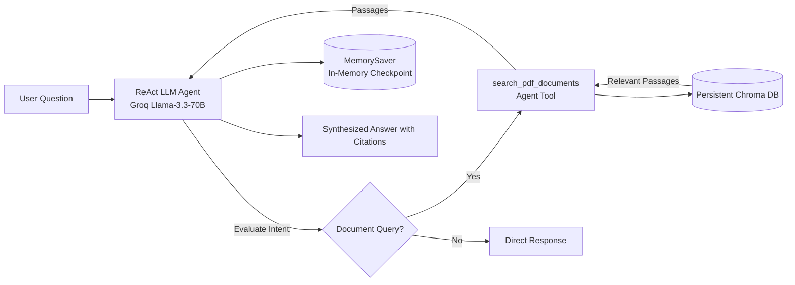
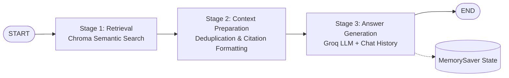

# 📚 RAG Document Assistant

A production-ready Conversational PDF Assistant built with **Python**, **LangChain**, **LangGraph**, **OpenAI Embeddings**, **ChromaDB**, **Groq**, and **Streamlit**.

This project implements two advanced Retrieval-Augmented Generation (RAG) architectures with persistent vector storage, multi-document recursive chunking, and conversational state checkpointing.

---

## 🌟 Key Highlights & Resume Alignment

| Resume Bullet Point | Architecture Implementation in this Repo |
| :--- | :--- |
| **Conversational PDF assistant with multi-document upload, recursive chunking & semantic retrieval** | `src/document_processor.py` supports batch PDF ingestion, page-level metadata extraction, recursive character chunking (1000 chunk size / 200 overlap), and OpenAI `text-embedding-3-small` embeddings. |
| **Document retrieval as an agent tool with in-memory checkpoints** | `src/agentic_rag.py` wraps Chroma retriever as a tool in a ReAct agent powered by Groq (`llama-3.3-70b-versatile`) with LangGraph `MemorySaver` in-memory checkpointing (`thread_id`). |
| **Persistent Chroma storage & LangGraph workflow with separate stages** | `src/workflow_rag.py` builds an explicit LangGraph `StateGraph` with 3 isolated stages: `retrieval_stage` ➔ `context_preparation_stage` ➔ `answer_generation_stage`. |

---

## 🏗️ Architecture Diagrams

### 1. Agentic RAG Mode (Tool Calling + Checkpoints)


### 2. Structured LangGraph Pipeline Mode (3 Stages)


---

## 🛠️ Tech Stack

- **Frameworks:** [LangChain](https://www.langchain.com/), [LangGraph](https://langchain-ai.github.io/langgraph/)
- **LLM Engine:** [Groq](https://groq.com/) (`llama-3.3-70b-versatile` / `llama-3.1-8b-instant`) for ultra-fast, high-accuracy inference
- **Embedding Models:** [OpenAI Embeddings](https://platform.openai.com/docs/guides/embeddings) (`text-embedding-3-small`) + HuggingFace (`all-MiniLM-L6-v2`) free offline fallback
- **Vector Database:** [ChromaDB](https://www.trychroma.com/) with persistent local disk storage
- **PDF Processing:** `pypdf` with `RecursiveCharacterTextSplitter`
- **Memory & State:** LangGraph `MemorySaver` checkpointing
- **User Interface:** [Streamlit](https://streamlit.io/)

---

## 📁 Project Structure

```text
rag-document-assistant/
│
├── .env.example             # Template for API keys
├── .gitignore               # Excludes secrets, venv, and Chroma DB files
├── requirements.txt         # Project dependencies
├── README.md                # Project documentation & interview guide
├── app.py                   # Streamlit web application & dual-mode UI
│
└── src/
    ├── __init__.py
    ├── config.py            # Global configuration & default hyperparameters
    ├── document_processor.py # PDF extraction, page metadata & recursive chunking
    ├── vector_store.py      # Chroma DB manager & embedding function factory
    ├── agentic_rag.py       # ReAct tool-calling agent with MemorySaver
    └── workflow_rag.py      # LangGraph 3-stage state graph pipeline
```

---

## 🚀 Getting Started (Local Setup)

### 1. Clone the repository
```bash
git clone https://github.com/<your-username>/rag-document-assistant.git
cd rag-document-assistant
```

### 2. Create and activate a virtual environment
```bash
# Windows
python -m venv venv
venv\Scripts\activate

# macOS / Linux
python3 -m venv venv
source venv/bin/activate
```

### 3. Install dependencies
```bash
pip install -r requirements.txt
```

### 4. Configure Environment Variables
Copy `.env.example` to `.env`:
```bash
cp .env.example .env
```
Fill in your API keys:
```ini
GROQ_API_KEY=gsk_your_groq_api_key_here
OPENAI_API_KEY=sk-your_openai_api_key_here
```
> **Tip:** You can obtain a free Groq API key at [console.groq.com](https://console.groq.com).

### 5. Run the Streamlit Application
```bash
streamlit run app.py
```

---

## 🌐 Free Hosting Guide (Streamlit Community Cloud)

You can host this project **100% free** so recruiters, hiring managers, and interviewers can test it live:

### Step 1: Push your code to GitHub
1. Create a new public repository on GitHub (e.g. `rag-document-assistant`).
2. In your local terminal:
```bash
git init
git add .
git commit -m "feat: complete RAG document assistant with LangGraph and Streamlit"
git branch -M main
git remote add origin https://github.com/<your-username>/rag-document-assistant.git
git push -u origin main
```

### Step 2: Deploy to Streamlit Community Cloud
1. Go to [share.streamlit.io](https://share.streamlit.io) and log in with GitHub.
2. Click **"New app"**.
3. Select your repository: `<your-username>/rag-document-assistant`, Branch: `main`, Main file path: `app.py`.
4. Click **"Advanced settings..."**:
   - Under **Secrets**, add your keys:
     ```toml
     GROQ_API_KEY = "gsk_..."
     OPENAI_API_KEY = "sk-..."
     ```
   *(Note: The app also allows users to input their own API keys via the sidebar UI if they prefer!)*
5. Click **"Deploy!"**.
6. Within 2 minutes, your live public URL (e.g. `https://rag-doc-assistant.streamlit.app`) will be active. Add this URL to your resume and LinkedIn profile!

---

## 🎯 Interview Q&A Cheatsheet (For This Project)

### Q1: Why did you implement two different RAG architectures?
> **Answer:** "I implemented both to compare autonomy vs predictability.
> 1. **Agentic RAG (Tool-Calling)** gives the model autonomy: it decides *if* and *when* retrieval is necessary. For conversational queries like 'Hi, what can you do?', it doesn't waste embedding computations or database queries.
> 2. **Structured LangGraph Pipeline** enforces deterministic execution through separate stages (`retrieve` ➔ `prepare_context` ➔ `generate_answer`). This gives fine-grained control over prompt engineering, chunk deduplication, and source attribution, making it ideal for strict compliance or audit requirements."

### Q2: How does conversational memory work across follow-up questions?
> **Answer:** "I used LangGraph's `MemorySaver` in-memory checkpointer. Each session has a unique `thread_id`. The checkpointer persists the graph's state across execution turns, preserving past interactions in the state's message history. When a user asks a follow-up question like 'Can you elaborate on point 2?', the model accesses prior turns to resolve coreferences seamlessly."

### Q3: Why recursive character chunking instead of fixed-length token splitting?
> **Answer:** "Fixed-length splitting can slice through words or sentences mid-thought, corrupting semantic meaning. `RecursiveCharacterTextSplitter` respects natural text hierarchy by trying paragraph breaks (`\n\n`), then line breaks (`\n`), then sentences (`. `), and only falling back to word spaces if necessary. We paired 1000-character chunks with a 200-character overlap to retain contextual continuity across chunk boundaries."

### Q4: Why Groq with Llama-3.3-70B?
> **Answer:** "Groq's LPU (Language Processing Unit) architecture provides sub-second inference speeds (over 250 tokens/sec) at very low cost. Combining fast Groq inference with OpenAI's dense embeddings gives near-instant RAG responses while maintaining high factual accuracy."
